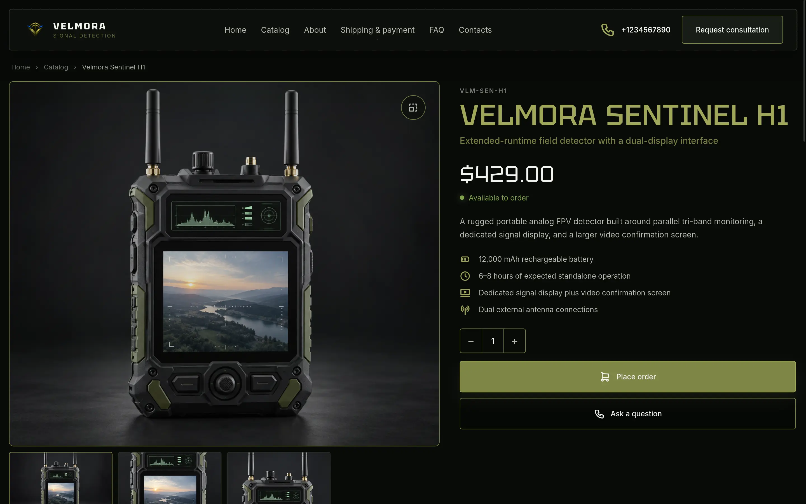
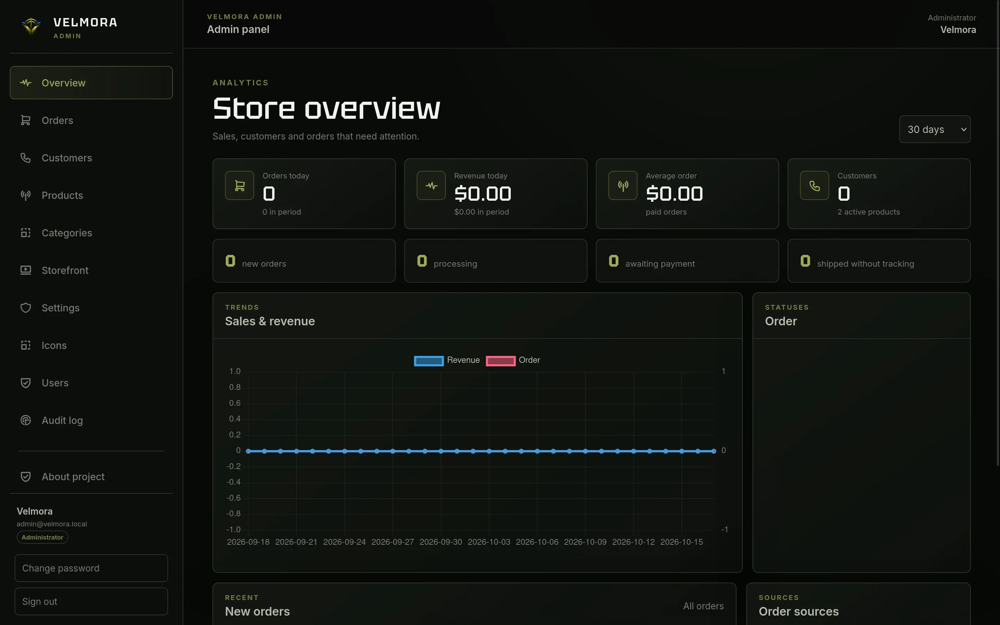

<div align="center">

# Velmora

**Your store. Your server.**

Open-source, self-hosted e-commerce built with Vue, FastAPI and PostgreSQL.
Run and customize an online store on infrastructure you control.

[](LICENSE)


[Features](#features) · [Quick start](#quick-start) · [Development](#development-and-testing) · [Security](#security) · [Contributing](#contributing)

</div>

## 📸 Screenshots

<p align="center">
  
</p>

<p align="center">
  
  
</p>

## Features

- **Storefront:** responsive catalog, product pages, search and filters.
- **Commerce:** checkout, order management, categories and optional stock tracking.
- **Storefront Builder:** manage branding, navigation, colors, sections, FAQ, dialogs and footer from the admin panel.
- **Administration:** manage products, orders, customers, staff roles, settings and audit logs.
- **Installer:** configure the database, store and first administrator in a browser.
- **Self-hosting:** Docker Compose, Caddy, PostgreSQL, backup and recovery utilities.
- **Open source:** project information and the installed version are available from the storefront.

Velmora can be customized for different types of stores. Product content, store details and shipping/payment methods are configured by the store operator.

## Quick start

**Requirements:** Linux, Docker Engine, Docker Compose v2 and a web browser. Python 3 is used by maintenance and validation scripts.

```bash
git clone https://github.com/xydojhuk/velmora.git
cd velmora

# Add "127.0.0.1 velmora.local" to /etc/hosts if it is not already present.
./scripts/local-init.sh
./scripts/local-up.sh
```

Open **http://velmora.local/install** and complete the initial setup. For an existing installation, open **http://velmora.local**.

The local setup creates `.env.local` and bootstrap credentials. Treat these files as secrets and **never commit or share them**.

### Local commands

```bash
./scripts/local-ps.sh             # Container status
./scripts/local-logs.sh backend   # Backend logs
./scripts/local-smoke.sh          # Smoke checks after installation
./scripts/local-backup.sh --quiesce
./velmora.sh version
```

**Data safety:** do not run `docker compose down -v` on an installed store. Removing volumes can destroy the database and uploaded media.

## Development and testing

Backend checks:

```bash
bash scripts/private-check.sh

cd backend
python3 -m venv .venv
.venv/bin/python -m pip install -r requirements-dev.txt
PYTHONPATH=. .venv/bin/python -m pytest -q
cd ..
```

Frontend checks (Node.js and npm required):

```bash
cd frontend
npm ci
npm run check
npm run build
cd ..
```

After installation, run `./scripts/local-smoke.sh`. Integration checks should also cover product creation, checkout, inventory changes, order cancellation and recovery from backup.

## Deployment

Velmora provides Docker Compose and Caddy configurations for self-hosting. Server installation tooling is available in `scripts/install.sh`.

**Alpha software:** review the deployment configuration, access controls, HTTPS, backups and recovery procedure before exposing an instance to the internet. Do not treat the development setup as a production configuration.

## Tech stack

| Component | Technologies |
| --- | --- |
| Storefront and admin | Vue 3, Vue Router, Vite, server-side rendering |
| API | FastAPI, Pydantic, SQLAlchemy, Alembic |
| Database | PostgreSQL |
| Infrastructure | Docker Compose, Caddy |

## Security

Please report security vulnerabilities privately according to [SECURITY.md](SECURITY.md). Never post credentials, access tokens or customer data in GitHub issues.

## Contributing

Bug reports, suggestions and pull requests are welcome. For bug reports, include the Velmora version (see [`VERSION`](VERSION)), steps to reproduce the issue, expected and actual behavior, and relevant sanitized logs.

- [Issues](https://github.com/xydojhuk/velmora/issues)
- [Source code](https://github.com/xydojhuk/velmora)

## License

Velmora is available under the [MIT License](LICENSE).
